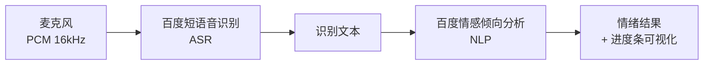

# InnerListener · 心聆

> 聆听内心的声音 —— 说一句话，看见情绪的颜色。

**InnerListener（心聆）** 是一款 Android 语音情感分析应用。它把你说的一句话录下来，先通过百度短语音识别转成文字，再通过百度情感倾向分析判断情绪，最后用一条从红到绿的进度条直观展示情绪的积极程度。

<p align="center">
  
  
  
</p>

---

## 功能特性

- **实时录音**：`AudioRecord` 采集 PCM 音频（16 kHz / 单声道 / 16 bit），最长 60 秒自动停止。
- **语音识别**：调用百度短语音识别（标准版），把语音转成中文文本。
- **情感分析**：调用百度情感倾向分析，输出「消极 / 中性 / 积极」、置信度以及积极/消极概率。
- **情绪可视化**：进度条长度与颜色随积极概率变化，红色代表消极，绿色代表积极。
- **交互反馈**：录音时背景呼吸动画、按钮脉动动画，识别与网络异常均有明确提示。
- **安全实践**：API 密钥通过 `local.properties` 注入，不写入源码、不提交仓库。

## 界面示意

```text
┌──────────────────────────────────┐
│  ████████████████░░░░░░░░  72%   │  ← 情绪积极程度
│  ┌────────────────────────────┐  │
│  │ 识别文字：                  │  │
│  │ 今天天气真好，心情不错       │  │
│  │                            │  │
│  │ 情绪结果：                  │  │
│  │ 倾向：积极                  │  │
│  │ 置信度：0.98                │  │
│  │ 积极概率：0.92              │  │
│  │ 消极概率：0.08              │  │
│  └────────────────────────────┘  │
│        [    开始录音    ]         │
└──────────────────────────────────┘
```

> 真机截图可放到 `docs/screenshots/` 并在本节引用。

## 工作原理



1. 点击「开始录音」，应用申请录音权限并开始采集 PCM 数据。
2. 点击「停止并分析」后，PCM 数据经 Base64 编码上传到百度短语音识别接口。
3. 识别出的文本再提交给情感倾向分析接口。
4. 解析 `positive_prob`，更新进度条进度与颜色。

## 技术栈

| 类别 | 选型 |
| --- | --- |
| 语言 | Kotlin 2.2 |
| 最低版本 | Android 7.0（API 24） |
| 编译/目标版本 | API 36 |
| 音频采集 | `AudioRecord`（PCM 16 bit） |
| 网络 | OkHttp 4 |
| 并发 | Kotlin Coroutines |
| UI | XML + AppCompat + CardView |
| 云服务 | 百度智能云 · 短语音识别 / 情感倾向分析 |

## 目录结构

```text
SoftInnoCode/
├── app/
│   ├── src/main/
│   │   ├── java/com/rongyou/xinling/MainActivity.kt   # 录音、识别、情感分析与动画
│   │   ├── res/layout/activity_main.xml               # 主界面
│   │   ├── res/drawable/                              # 按钮与进度条样式
│   │   └── AndroidManifest.xml
│   ├── src/test/                                      # 本地单元测试
│   ├── src/androidTest/                               # 仪器化测试
│   ├── build.gradle.kts
│   └── proguard-rules.pro
├── gradle/
│   ├── libs.versions.toml                             # 依赖版本目录
│   └── wrapper/
├── .github/workflows/android.yml                      # GitHub Actions 构建
├── local.properties.example                           # 密钥配置模板
├── build.gradle.kts
├── settings.gradle.kts
├── README.md
└── LICENSE
```

## 快速开始

### 1. 环境要求

- Android Studio（推荐 2024.2 及以上）或命令行 Gradle 环境
- JDK 17 或更高（Android Studio 自带 JBR 21 即可）
- Android SDK Platform 36、Build-Tools
- Android 7.0（API 24）及以上的真机或模拟器

### 2. 申请百度智能云凭证

在 [百度智能云控制台](https://console.bce.baidu.com/ai/) 创建 **两个应用**：

| 应用 | 用途 | 需要的凭证 |
| --- | --- | --- |
| 短语音识别（标准版） | 语音转文字 | API Key / Secret Key |
| 情感倾向分析 | 文本情绪判断 | API Key / Secret Key |

> 两个应用分别开通、分别计费，请勿混用同一套 Key。

### 3. 配置密钥

复制 `local.properties.example` 为 `local.properties`，填写 SDK 路径和两套 Key：

```properties
sdk.dir=C\:\\Users\\your_name\\AppData\\Local\\Android\\Sdk

BAIDU_SPEECH_API_KEY=你的短语音识别_API_Key
BAIDU_SPEECH_SECRET_KEY=你的短语音识别_Secret_Key
BAIDU_NLP_API_KEY=你的情感分析_API_Key
BAIDU_NLP_SECRET_KEY=你的情感分析_Secret_Key
```

`local.properties` 已被 `.gitignore` 忽略，不会进入版本库。构建时 Gradle 会把这些值写入 `BuildConfig`。

### 4. 在 Android Studio 中运行

1. `File → Open`，选择项目根目录（`SoftInnoCode`）。
2. 等待 Gradle Sync 完成。
3. 连接真机或启动模拟器，点击 Run。

### 5. 不用 Android Studio：本地命令行构建与运行

可以。本项目是标准 Gradle Android 工程，**不需要 Android Studio 也能改代码和构建**，用任意编辑器（VS Code、IntelliJ IDEA、记事本）都可以。

但需要说明：**Android 应用不能像桌面程序一样“双击直接运行”**。构建产物是 APK，必须安装到 Android 模拟器或真机后才能运行。

**Windows：**

```bat
gradlew.bat assembleDebug
adb install -r app\build\outputs\apk\debug\app-debug.apk
adb shell am start -n com.rongyou.xinling/.MainActivity
```

**macOS / Linux：**

```bash
./gradlew assembleDebug
adb install -r app/build/outputs/apk/debug/app-debug.apk
adb shell am start -n com.rongyou.xinling/.MainActivity
```

命令行环境需要提前准备：

1. **JDK 17+**：命令行执行 `java -version` 确认。
2. **Android SDK**：安装 Android SDK Command-line Tools 与 Platform 36；设置环境变量 `ANDROID_HOME`，或在 `local.properties` 中写 `sdk.dir`。
3. **adb**：位于 `Android SDK/platform-tools/`，用于安装 APK。
4. **模拟器或真机**：真机需开启「开发者选项 → USB 调试」；模拟器可用 `emulator -avd <设备名>` 启动。

构建其他变体：

```bash
./gradlew assembleRelease   # Release APK（默认未签名，需自行配置签名）
./gradlew testDebugUnitTest # 运行单元测试
./gradlew lintDebug         # 静态检查
```

> 如果你只是评审代码，也可以直接阅读 `app/src/main/java/com/rongyou/xinling/MainActivity.kt`，无需构建。

## 隐私与安全

- 录音数据只保存在内存中，不写入本地文件，仅在点击分析时上传到百度 API。
- API 密钥保存在本机 `local.properties`，源码与仓库中不包含任何密钥。
- **注意**：密钥会被编译进 APK，客户端应用无法真正隐藏密钥。本项目仅用于学习与作品演示；正式产品应通过自建服务端代理调用百度 API，避免密钥随 APK 泄露。
- 如果你拿到的是早期版本源码（曾硬编码密钥），请立即到百度控制台**重置 Key/Secret**。

## 常见问题

| 问题 | 排查方向 |
| --- | --- |
| 提示「尚未配置百度智能云密钥」 | 检查 `local.properties` 中四个字段是否填写，改完后重新 Sync / 构建 |
| Gradle Sync 很慢或失败 | 检查网络；`settings.gradle.kts` 已配置阿里云镜像。若下载 Gradle 本体较慢，可把 `gradle/wrapper/gradle-wrapper.properties` 的 `distributionUrl` 换成腾讯镜像 `https://mirrors.cloud.tencent.com/gradle/gradle-9.3.0-bin.zip` |
| 识别返回 `err_no` | 查看百度控制台对应应用是否开通、配额是否用完、Key 是否匹配 |
| 模拟器录不到声音 | 模拟器设置中开启 Host audio input（麦克风） |
| 安装时提示应用未安装 | 确认设备 API ≥ 24，并先卸载旧包 `adb uninstall com.rongyou.xinling` |

## Roadmap

- [ ] 识别历史记录与本地留存
- [ ] 支持更长语音与实时流式识别
- [ ] 情绪结果的可视化图表
- [ ] 迁移到 Jetpack Compose
- [ ] 服务端密钥代理 / 自建后端

## 许可证

本项目基于 [MIT License](LICENSE) 开源。

Copyright © 2026 杨荣友 (Yang Rongyou)
